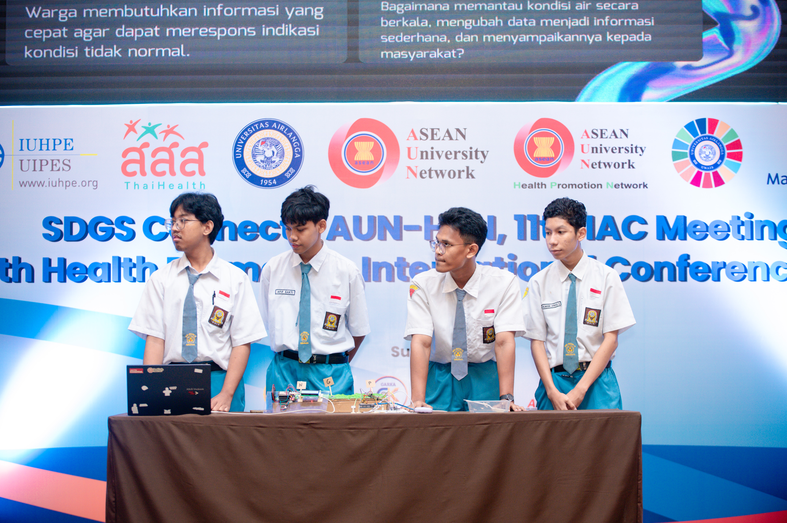
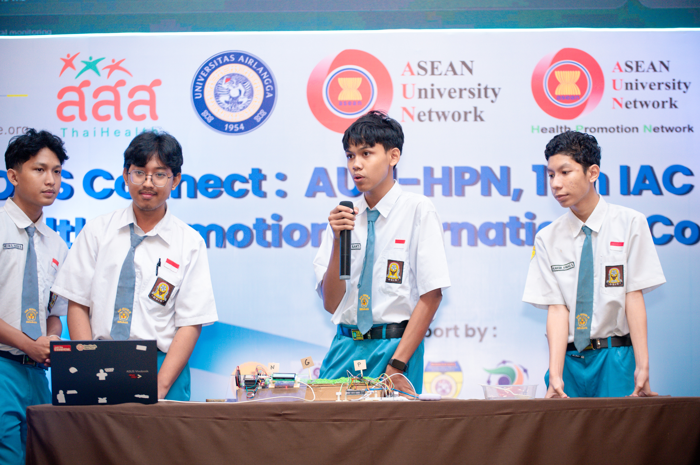

# ECOSTREAM 2026 — SDGs Connect

> Documenting my journey, contributions, and achievement in the ECOSTREAM 2026 competition.

  

  

## Overview

**ECOSTREAM 2026 — SDGs Connect** is a technology competition focused on innovation and sustainability through the application of technology.

This competition provided an opportunity to explore ideas, develop innovative solutions, collaborate with a team, and present technological concepts related to sustainable development.

## Competition Information

| Information | Details |
|---|---|
| Competition | ECOSTREAM 2026 |
| Theme | SDGs Connect |
| Organizer | Universitas Airlangga (UNAIR) |
| Field | Internet of Things (IoT) |
| Year | 2026 |
| Achievement | 2nd Place |
| Participation | Team Competition |

## Achievement

🏆 **2nd Place — ECOSTREAM 2026**

Successfully secured second place in the ECOSTREAM 2026 competition.

This achievement represents an important milestone in my journey in technology, innovation, and collaborative problem-solving.

## My Contribution

My involvement in this competition included:

- Developing the initial project concept and ideas.
- Contributing to proposal writing and project planning.
- Preparing the technical blueprint and system concept.
- Exploring the application of IoT technology.
- Participating in project development and presentation preparation.

### Team

  

*Team documentation during ECOSTREAM 2026.*

## Certificate

The official certificate documenting this achievement:

[View Certificate (PDF)](certificate.pdf)

## Experience & Learning

Through this competition, I gained experience in:

- IoT innovation and implementation.
- Technical planning and system design.
- Proposal development and technical documentation.
- Team collaboration and communication.
- Presenting technological ideas.

## Reflection

ECOSTREAM 2026 was a valuable experience that challenged me to transform ideas into innovative technological concepts.

Achieving **2nd Place** was a meaningful milestone and motivation to continue learning, experimenting, and developing solutions that create a positive impact.

---

  <i>Keep learning. Keep building. Keep innovating.</i>

