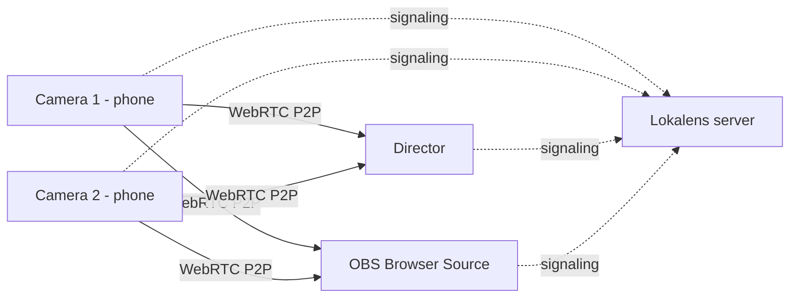

<div align="center">

# 🔴 LOKALENS

**Multi-device cameras over your local network for OBS and live streaming.**
*No internet required. No load on your stream's bandwidth.*


<br>

[](https://github.com/afifcom321/lokalens)

<sub>Opens the live repository with source code, installation guide, and full documentation.</sub>

</div>

---

> 📂 **Personal Archive** · `04 — Projects` · [← Back to Archive](../../README.md)

## 01 / OVERVIEW

Lokalens turns phones, laptops, and webcams on the same local network into camera sources for **OBS Studio**. Open a web page on a phone, tap **START STREAM**, and the picture appears in the Director and in OBS, all over the same Wi-Fi/LAN.

The concept is inspired by [VDO.Ninja](https://vdo.ninja), but everything runs on the local network. The web app, signaling, and QR codes are served by a small server on the user's own PC, while video and audio flow directly between devices over WebRTC P2P. There is no CDN and no cloud service.

## 02 / THE PROBLEM

At an event, the venue's internet is usually limited and already busy carrying the main broadcast to YouTube, Facebook, or another platform. If extra camera feeds also travel over the internet, they compete with that broadcast for the same bandwidth.

Lokalens keeps the two separate:

```text
Camera feeds    Phone ──► local Wi-Fi / LAN ──► OBS                (never touches the internet)
Main broadcast  OBS ──► Internet ──► YouTube / Facebook / etc.     (bandwidth stays free)
```

- Internet bandwidth stays reserved for the broadcast.
- Keeps working if the venue's internet is slow or drops.
- The server never relays video, so the server PC stays light.

**Trade-off:** all devices must be on the same network, so Lokalens cannot take remote guests from outside the venue.

## 03 / PROJECT AT A GLANCE

| | |
|---|---|
| **Project** | Lokalens |
| **Version** | 1.0.0 (V1) |
| **Type** | Self-hosted web application |
| **Domain** | Live streaming · Networking · WebRTC |
| **Runtime** | Node.js 20+ |
| **Server** | Express + Socket.IO (signaling only) |
| **Media transport** | WebRTC P2P |
| **Frontend** | Static HTML / CSS / JavaScript, no build step, no CDN |
| **Database** | None (rooms live in server memory) |
| **License** | MIT |
| **Source** | [github.com/afifcom321/lokalens](https://github.com/afifcom321/lokalens) |

## 04 / KEY FEATURES

**📱 Camera (sender)**
- Camera and microphone selection with live preview
- Resolution Auto / 360p / 480p / 720p / 1080p, 24 / 30 / 60 FPS, bitrate Auto / 1–8 Mbps
- Mic mute, front/back camera switch, live stats, automatic signaling reconnect
- Persistent device key, so a camera keeps its identity across sessions

**🎛️ Director (viewer)**
- Create or join a room, with a QR code for cameras to join
- Multi-camera preview, fullscreen, rename, hide/show, disconnect
- **COPY OBS URL** button for each camera

**🎬 OBS**
- Minimal `/obs/...` page: video only, black background
- Served over plain HTTP on a separate port, so OBS has no trouble with the self-signed certificate

**📊 Performance Monitor**
- Reads `RTCPeerConnection.getStats()`: resolution, FPS, bitrate, packet loss, RTT, jitter, connection state, codec

## 05 / HOW IT WORKS



- **Media** goes straight from camera to viewer. No video bytes pass through the server.
- **The server** handles only the web app, signaling, room management, device metadata, and QR codes (generated locally, no online QR service).

## 06 / QUICK START

```bash
git clone https://github.com/afifcom321/lokalens.git
cd lokalens
npm install
npm run cert   # generate the local HTTPS certificate (once)
npm start
```

Then open `https://<LAN-IP>:3000/director` on the PC, create a room, scan the QR code with a phone, and paste the **COPY OBS URL** link into an OBS Browser Source.

For the full guide (firewall, configuration, troubleshooting, event tips), see the [main repository](https://github.com/afifcom321/lokalens).

## 07 / V1 LIMITATIONS

- LAN only; devices outside the same network cannot connect
- P2P mesh: a camera's upload grows with the number of viewers
- Audio on the OBS page is muted in V1
- Password-protected rooms don't work with OBS and Stats pages
- Rooms live in memory and disappear on server restart
- Self-signed certificate shows a browser warning on the first visit

## 08 / ROADMAP

- [ ] Audio to OBS (with an unmute option)
- [ ] Local SFU, so a camera uploads one stream regardless of viewer count
- [ ] Password support on OBS and Stats pages
- [ ] Screen Wake Lock on the camera page
- [ ] Per-viewer bitrate
- [ ] Recording and NDI / SRT / RTMP output
- [ ] UI localization (English / Indonesian)

## 09 / DOCUMENTATION

<!--
Add screenshots to the documentation/ folder, then uncomment:


-->

*Screenshots and demo documentation will be added to the `documentation/` folder.*

## 10 / LINKS

| | |
|---|---|
| 🔗 **Source code** | [github.com/afifcom321/lokalens](https://github.com/afifcom321/lokalens) |
| 📖 **Inspiration** | [VDO.Ninja](https://vdo.ninja) |
| 📂 **Back to archive** | [Personal Archive](../../README.md) |

---

<div align="center">

[](https://github.com/afifcom321/Lokalens)

<sub>Lokalens is an independent project, not affiliated with VDO.Ninja or OBS Studio.</sub>
<br>
<sub>Personal Archive · Afif Sakti Widialukman ([@afifcom321](https://github.com/afifcom321))</sub>

</div>
