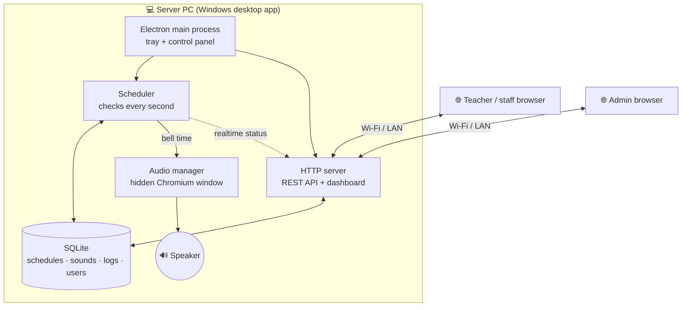

<div align="center">

# 🔔 SCHOOL BELL SYSTEM

**Automatic school bell: a Windows desktop app with a local server and a web dashboard.**
*Runs entirely on the school network. No internet required for daily operation.*


<br>

[](https://github.com/afifcom321/School-Bell-System)

<sub>Opens the live repository with source code, installer downloads, and full documentation.</sub>

</div>

---

> 📂 **Personal Archive** · `04 — Projects` · [← Back to Archive](../../README.md)

## 01 / OVERVIEW

School Bell System is an automatic school bell. One Windows desktop app runs a **local server** that schedules and rings the bell on time, with no browser needing to stay open. It also serves a **web dashboard** that any computer or phone on the same school network can use to manage schedules, sounds, and settings.

It is built with Electron, Node.js, and SQLite, and runs fully on the local network.

## 02 / THE PROBLEM

Many homemade bell apps rely on a single `setTimeout` calculated once at startup. These drift over time, and they lose their place completely when the app restarts. They also often depend on a browser tab staying open.

School Bell System takes a different approach:

- The scheduler and the server run **on the computer**, not in a browser tab. Closing every dashboard does not affect the bell.
- Bell times are computed from the **real system clock**, not from how often a loop happens to run.
- The next bell is **recalculated** from the schedule and the current time after every restart, so nothing is lost.

## 03 / PROJECT AT A GLANCE

| | |
|---|---|
| **Project** | School Bell System |
| **Type** | Windows desktop app + local web dashboard |
| **Domain** | Scheduling · Desktop apps · Local-network web apps |
| **Desktop shell** | Electron (tray icon, control panel, autostart) |
| **Server / API** | Node.js + Express |
| **Database** | `node:sqlite`, the SQLite module built into Node.js (no native addon) |
| **Dashboard** | Vanilla HTML / CSS / JS, no framework, no build step |
| **Realtime** | Server-Sent Events (SSE) |
| **Auth** | Cookie sessions + scrypt password hashing |
| **Packaging** | electron-builder (NSIS installer + portable) |
| **Testing** | Node.js built-in test runner (`node --test`) |
| **License** | MIT |
| **Source** | [github.com/afifcom321/School-Bell-System](https://github.com/afifcom321/School-Bell-System) |

## 04 / KEY FEATURES

**⏰ Scheduling**
- Accurate and restart-safe: restarting at 07:29 still knows the next bell is 07:30, and never rings twice
- Recurring by weekday (e.g. Monday–Friday) or on a specific date
- Different sound and volume per schedule, enable/disable without deleting
- Import and export schedules as JSON
- Exam mode, temporary pause, and holiday date ranges

**🔊 Sound management**
- Upload MP3 / WAV / OGG with drag-and-drop
- Preview in the browser, set volume and duration limit per sound

**🖥️ Dashboard**
- Live clock, countdown to the next bell, and status synced across every open device
- Roles: **Administrator** (full control) and **Viewer** (read-only, e.g. for the teacher on duty)
- Full logs of every bell (rung / failed / missed / skipped) and every settings change, with time and actor

**🛡️ Reliability**
- One-click database backup and restore, plus automatic daily backup
- Prevents the PC from sleeping so bells are not missed
- System tray icon and autostart when Windows boots

## 05 / HOW IT WORKS

The desktop app wraps an ordinary web server. The dashboard that a teacher opens on a phone is just a **client** talking to that server through a REST API and realtime events.



### Scheduling algorithm

1. A lightweight loop runs about once per second, aligned to the system clock's second boundary.
2. Every tick is computed from the real time (`Date.now()`), so a laggy computer does not skew results.
3. **Anti-double-ring:** each schedule that has rung is marked `YYYY-MM-DD HH:MM` in the database.
4. **Restart-safe:** the next bell is always derived from the schedule and the current time, never held only in memory.
5. **Catch-up tolerance:** a bell up to the configured limit late (default 120 s) still rings. Beyond that, it is logged as "missed" instead of ringing late.

## 06 / QUICK START

**For users**

1. Download the installer from [Releases](https://github.com/afifcom321/School-Bell-System/releases).
2. Run it and open the app from the Desktop or Start Menu.
3. Open `http://localhost:3000`, or click **Open Dashboard** in the control panel.
4. On first login the system requires a password change before anything else.

**For developers** (Node.js 22.13+)

```bash
git clone https://github.com/afifcom321/School-Bell-System.git
cd School-Bell-System
npm install
npm start               # desktop app (dev mode)
npm run server          # server only, without Electron
npm run build:win-installer
```

Other devices on the same Wi-Fi/LAN can open the dashboard at `http://<SERVER-PC-IP>:3000`.

For the full guide (security details, firewall, troubleshooting), see the [main repository](https://github.com/afifcom321/School-Bell-System).

## 07 / SECURITY HIGHLIGHTS

- Passwords hashed with **scrypt**
- `HttpOnly` + `SameSite=Lax` session cookies, plus `Origin` checks against CSRF
- Login attempt limiting (5 failures → 5-minute lockout)
- Sound uploads validated by extension, MIME type, **and** file signature (magic bytes)
- Server-side filenames are always regenerated randomly, to prevent path traversal
- Standard security headers (CSP, `X-Frame-Options`, etc.) on the dashboard

## 08 / TESTING

```bash
npm test
```

Covers scheduler accuracy (simulated restarts, delays, and database failures) and every REST API endpoint (authentication, input validation, sound upload, backup/restore).

## 09 / DOCUMENTATION

<!--
Add screenshots to the documentation/ folder, then uncomment:


-->

*Screenshots and demo documentation will be added to the `documentation/` folder.*

## 10 / LINKS

| | |
|---|---|
| 🔗 **Source code** | [github.com/afifcom321/School-Bell-System](https://github.com/afifcom321/School-Bell-System) |
| 📥 **Releases** | [Download installer](https://github.com/afifcom321/School-Bell-System/releases) |
| 📂 **Back to archive** | [Personal Archive](../../README.md) |

---

<div align="center">

[](https://github.com/afifcom321/School-Bell-System)

<sub>Personal Archive · Afif Sakti Widialukman ([@afifcom321](https://github.com/afifcom321))</sub>

</div>
