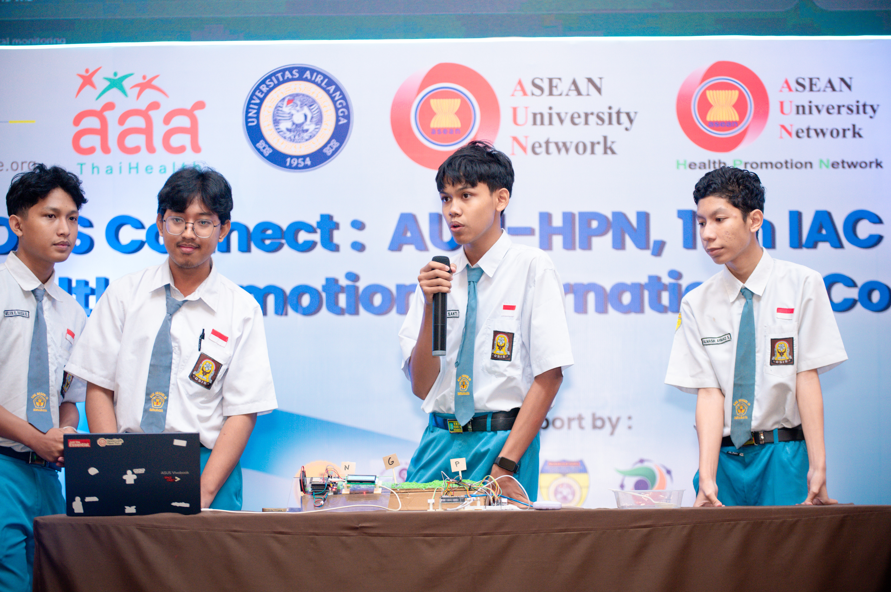
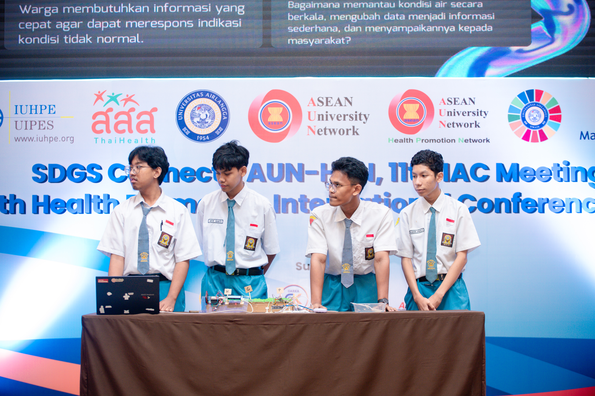

# ◈ AFIF SAKTI WIDIALUKMAN — PERSONAL ARCHIVE

<p align="center">
  
</p>

<p align="center">
  <b>Afif Sakti Widialukman's documented journey of learning, achievements, experiments, and experiences.</b>
  <br/>
  <i>Every experience has a story. Every achievement has a process.</i>
</p>

<p align="center">
  
  
  
  
</p>

---

## 01 / INTRODUCTION

Welcome to the personal archive of **Afif Sakti Widialukman**.

This repository is a centralized collection of my learning journey, achievements, certifications, competitions, technical projects, and experiences in Internet of Things (IoT), web development, Linux, and cybersecurity.

More than just a collection of certificates, this archive documents the process behind every milestone — from learning new technologies and participating in competitions to developing projects and exploring new fields.

**The purpose is simple:** to document progress, preserve experiences, and build a record of continuous learning.

## 02 / ARCHIVE DIRECTORY

| Directory | Description | Status |
|:---|:---|:---:|
| [01 — Achievements](./01-achievements/) | Competitions, awards, and achievements | ✅ Available |
| [02 — Courses & Certifications](./02-courses-certifications/) | Courses, training, and certifications | ✅ Available |
| 03 — CTF & Cybersecurity | Cybersecurity competitions and CTF | 🔜 Coming soon |
| [04 — Projects](./04-projects/) | IoT, web development, and experiments — 3 projects | ✅ Available |
| 05 — Organizations | Organizational and leadership experiences | 🔜 Coming soon |
| 06 — Events & Experiences | Seminars, workshops, and other activities | 🔜 Coming soon |

## 03 / FEATURED MOMENTS

A visual collection of selected moments from the activities and competitions of Afif Sakti Widialukman.

### ECOSTREAM 2026 — SDGs Connect

<p align="center">
  
  
</p>

<p align="center">
  <b>ECOSTREAM 2026 — Universitas Airlangga</b>
  <br/>
  
  <br/>
  <sub>Project presentation and team documentation by Afif Sakti Widialukman.</sub>
  <br/>
  <a href="01-achievements/competitions/ecostream-2026/README.md">Explore Competition →</a>
</p>

## 04 / FEATURED PROJECTS

Tools built to solve real, practical problems. Each project has a summary in this archive and a link to its live repository.

| Project | What it does | Stack | Links |
|:---|:---|:---|:---|
| 🔴 **Lokalens** | Multi-device cameras over the local network for OBS and live streaming, with no internet required | Node.js · WebRTC · Socket.IO | [Summary](./04-projects/Lokalens/README.md) |
| 🔔 **School Bell System** | Automatic school bell: a Windows app with a local server and a web dashboard | Electron · Node.js · SQLite | [Summary](./04-projects/school-bell-system/README.md) |
| 🌡️ **GT30Pro Thermal Kill** | KernelSU module that bypasses thermal throttling on the Infinix GT 30 Pro, for benchmarks only | KernelSU · Shell · MediaTek | [Summary](./04-projects/gt30pro-thermal-kill/README.md) |

<p align="center">
  <a href="https://github.com/afifcom321/lokalens"></a>
  <a href="https://github.com/afifcom321/School-Bell-System"></a>
  <a href="https://github.com/afifcom321/Infinix-gt-30-pro-Disable-Thermal-"></a>
</p>

<p align="center">
  <a href="./04-projects/README.md">Read why each project was built →</a>
</p>

## 05 / CERTIFICATE COLLECTION

A collection of certificates documenting the participation, achievements, and learning progress of Afif Sakti Widialukman.

| Certificate | Category | Document |
|:---|:---|:---:|
| ECOSTREAM 2026 — 2nd Place · Afif Sakti Widialukman | Competition | [View PDF ↗](01-achievements/competitions/ecostream-2026/certificate.pdf) |
| JCC Jatim Cyber Security · Afif Sakti Widialukman | Cybersecurity | [View PDF ↗](01-achievements/competitions/JCC/certificate.pdf) |
| Linux Command Line: From Zero to Hero · Afif Sakti Widialukman | Udemy Course | [View PDF ↗](02-courses-certifications/linux/certificate.pdf) |

> Certificates are linked directly to their respective files in this repository.

## 06 / AREAS OF INTEREST

My current areas of exploration and development.

<p align="center">
  
  
  
  
  
</p>

## 07 / HIGHLIGHTS

- **ECOSTREAM 2026 — UNAIR:** 2nd Place — Afif Sakti Widialukman.
- **JCC Jatim Cyber Security:** Online competition participant — Afif Sakti Widialukman.
- **Linux Command Line:** Udemy course completion — Afif Sakti Widialukman.
- **Lokalens:** Local-network multi-camera streaming for OBS, built on WebRTC P2P.
- **School Bell System:** Windows desktop app with a restart-safe bell scheduler and a local web dashboard.
- **GT30Pro Thermal Kill:** KernelSU module for thermal bypass during benchmark sessions.

Each entry includes relevant certificates, descriptions, and available documentation.

## 08 / DOCUMENTATION STANDARD

Every activity is organized using a consistent structure.

```text
activity-name/
│
├── README.md
├── certificate.pdf
├── documentation/
│   ├── photo-01.jpg
│   └── photo-02.jpg
└── supporting-files/
```

Depending on the activity, not every directory will contain all these files.

## 09 / PHILOSOPHY

Not every experience results in a trophy. Not every project becomes a finished product.

Some experiences bring recognition, while others provide lessons, technical knowledge, and opportunities to improve.

This archive values both.

**Learning is progress. Building is practice. Documenting is preserving the journey.**

## 10 / ABOUT THE OWNER

**Afif Sakti Widialukman** (GitHub: [@afifcom321](https://github.com/afifcom321)) — learner and builder with interests in IoT, web development, Linux, and cybersecurity. This repository is the official record of his achievements, certifications, and projects.

---

<p align="center">
  <b>KEEP LEARNING. KEEP BUILDING. KEEP EXPLORING.</b>
  <br/><br/>
  <sub>Personal Archive · Afif Sakti Widialukman (<a href="https://github.com/afifcom321">@afifcom321</a>)</sub>
  <br/>
  <sub>© 2026 Afif Sakti Widialukman — A continuous record of growth.</sub>
</p>
